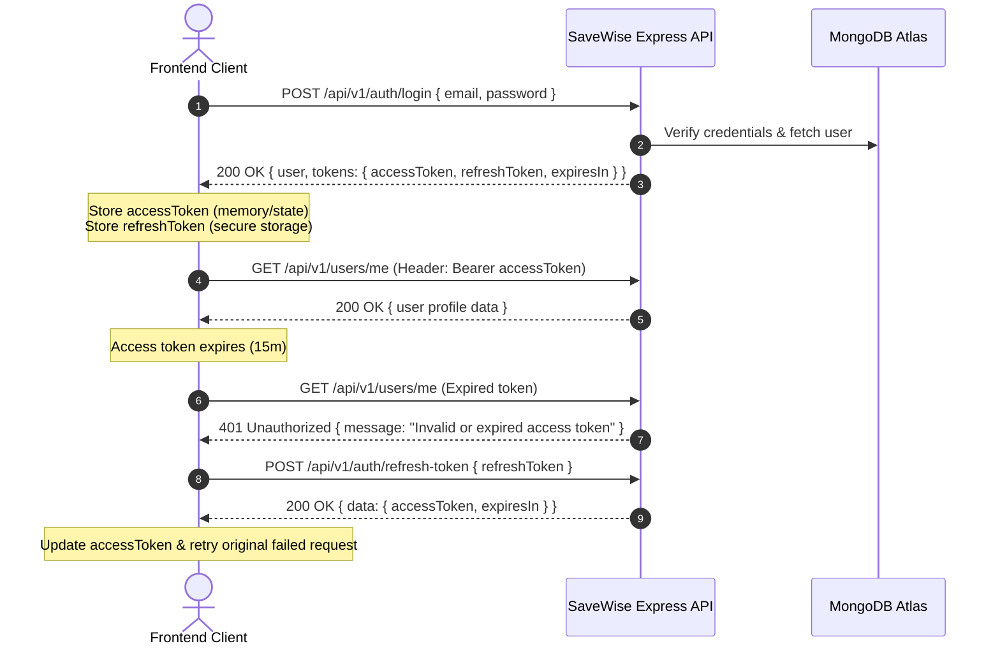

# SaveWise API — Postman Collection & Frontend Integration Reference

This reference is tailored for **Front-End Engineers** (React, Next.js, Vue, React Native, Flutter, Angular) integrating with the **SaveWise REST API**. It details endpoint contracts, JWT token lifecycle strategies, request/response payloads, validation rules, and instructions for importing and running the collection directly in your Postman account workspace.

---

## 📌 Quick Reference & Environments

| Environment | Base URL (`{{baseUrl}}`) | Status | Description |
| :--- | :--- | :--- | :--- |
| **Live Production** | `https://save-wise-nodejs-api-server.onrender.com` | 🟢 Online | Hosted on Render with MongoDB Atlas |
| **Local Development** | `http://localhost:5000` | 💻 Local | Local Express API server |

- **API Version Route Prefix:** `/api/v1`
- **Default Content-Type:** `application/json`
- **Auth Header:** `Authorization: Bearer <accessToken>`

---

## 📥 Importing into Your Postman Account

The collection file is located in the root of the repository:
📁 **[`SaveWise_API_Collection.json`](./SaveWise_API_Collection.json)**

### Step-by-Step Import to Postman Account Workspace:
1. Open your **Postman** desktop app or navigate to **[Postman Web](https://go.postman.co)**.
2. Ensure you are signed in to your Postman account (e.g. Workspace: *SaveWise* or *My Workspace*).
3. Click the **Import** button in the top-left corner of the sidebar.
4. Drag and drop `SaveWise_API_Collection.json` (or click **files** and select it).
5. Postman will automatically create the collection:
   **`SaveWise API - v1 (Node.js Express TypeScript MongoDB Atlas)`**
6. Select the collection and open the **Variables** tab:
   - `baseUrl`: Set to `https://save-wise-nodejs-api-server.onrender.com` (for live) or `http://localhost:5000` (for local).
   - `accessToken`: (Leave blank; auto-populated by Register/Login test scripts).
   - `refreshToken`: (Leave blank; auto-populated by Register/Login test scripts).
7. *(Optional for Sharing)*: Click the three dots `...` next to the collection in Postman -> **Share** -> Share with your team or generate a public view link for fellow front-end engineers.

---

## 🔐 Authentication & JWT Dual-Token Architecture

SaveWise uses a secure dual-token authentication pattern:
- **Access Token:** Short-lived JWT (`15m`) used to authorize protected routes (`/api/v1/users/*`). Sent in the `Authorization` header as `Bearer <token>`.
- **Refresh Token:** Long-lived JWT (`30d`) used exclusively to obtain fresh access tokens via `POST /api/v1/auth/refresh-token`.



### 💡 Front-End Axios Interceptor Pattern (Silent Token Refresh)
```typescript
import axios from 'axios';

const api = axios.create({
  baseURL: 'https://save-wise-nodejs-api-server.onrender.com/api/v1',
});

let accessToken: string | null = null;

export const setAccessToken = (token: string | null) => {
  accessToken = token;
};

// Request Interceptor: Attach Bearer Token
api.interceptors.request.use((config) => {
  if (accessToken && !config.headers.Authorization) {
    config.headers.Authorization = `Bearer ${accessToken}`;
  }
  return config;
});

// Response Interceptor: Silent Token Refresh on 401
api.interceptors.response.use(
  (response) => response,
  async (error) => {
    const originalRequest = error.config;
    if (error.response?.status === 401 && !originalRequest._retry) {
      originalRequest._retry = true;
      try {
        const storedRefreshToken = localStorage.getItem('refreshToken');
        if (!storedRefreshToken) throw new Error('No refresh token available');

        const { data } = await axios.post(
          'https://save-wise-nodejs-api-server.onrender.com/api/v1/auth/refresh-token',
          { refreshToken: storedRefreshToken }
        );

        const newAccessToken = data.data.accessToken;
        setAccessToken(newAccessToken);
        originalRequest.headers.Authorization = `Bearer ${newAccessToken}`;
        return api(originalRequest);
      } catch (refreshErr) {
        setAccessToken(null);
        localStorage.removeItem('refreshToken');
        window.location.href = '/login';
        return Promise.reject(refreshErr);
      }
    }
    return Promise.reject(error);
  }
);

export default api;
```

---

## 📦 Standard API Response Envelopes

All responses from SaveWise adhere strictly to the standardized envelope.

### 1. Success Response Structure (`200 OK` / `201 Created`)
```json
{
  "success": true,
  "message": "Operation successful description",
  "data": { ... }
}
```

### 2. Standard Error Response (`400`, `401`, `403`, `404`, `409`, `500`)
```json
{
  "success": false,
  "message": "Specific error explanation"
}
```

### 3. Zod Validation Error Response (`422 Unprocessable Entity`)
When request body validation fails, `errors` contains an array of field-level errors:
```json
{
  "success": false,
  "message": "Validation failed",
  "errors": [
    {
      "field": "password",
      "message": "Password must be at least 8 characters long and include at least one uppercase letter, one number, and one special character"
    },
    {
      "field": "email",
      "message": "Invalid email address format"
    }
  ]
}
```
> **Front-end Tip:** Map `errors` directly into form field helper texts:
> ```javascript
> const fieldErrors = {};
> response.data.errors?.forEach(err => { fieldErrors[err.field] = err.message; });
> ```

---

## 📡 Endpoint Specifications & Payloads

### 1. System & Health

#### `GET /` — Welcome & Directory
- **Auth:** None
- **Response `200 OK`:**
```json
{
  "message": "Welcome to SaveWise API",
  "version": "1.0.0",
  "environment": "production",
  "endpoints": {
    "health": "/health",
    "auth": "/api/v1/auth",
    "users": "/api/v1/users"
  }
}
```

#### `GET /health` — Service Health & Uptime
- **Auth:** None
- **Response `200 OK`:**
```json
{
  "status": "ok",
  "timestamp": "2026-11-23T15:55:00.000Z",
  "uptime": "2h 15m 32s"
}
```

---

### 2. Authentication (`/api/v1/auth`)

#### `POST /api/v1/auth/register` — User Registration
- **Auth:** None
- **Validation Rules:**
  - `email`: Valid email string, trimmed, lowercase.
  - `password`: Min 8 characters, >= 1 uppercase letter, >= 1 number, >= 1 special character (`!@#$%^&*()_+-=[]{};':"\\|,.<>/?`).
  - `firstName`: String, 1–50 characters (required).
  - `lastName`: String, 1–50 characters (required).
  - `phoneNumber`: String (optional).
  - `dateOfBirth`: ISO 8601 Date string e.g. `"1995-06-15"` (optional).
- **Request Body:**
```json
{
  "email": "sarah.smith@example.com",
  "password": "SecurePassword123!",
  "firstName": "Sarah",
  "lastName": "Smith",
  "phoneNumber": "+254712345678",
  "dateOfBirth": "1995-06-15"
}
```
- **Response `201 Created`:**
```json
{
  "success": true,
  "message": "User registered successfully",
  "data": {
    "user": {
      "id": "6741fe7ab2c1040012e84123",
      "email": "sarah.smith@example.com",
      "profile": {
        "firstName": "Sarah",
        "lastName": "Smith",
        "avatarUrl": ""
      },
      "status": "ACTIVE"
    },
    "tokens": {
      "accessToken": "eyJhbGciOi...",
      "refreshToken": "eyJhbGciOi...",
      "expiresIn": "15m"
    }
  }
}
```
- **Error Responses:**
  - `409 Conflict`: `{"success": false, "message": "An account with that email already exists."}`
  - `422 Unprocessable Entity`: Field validation failed (e.g. weak password or invalid email).

---

#### `POST /api/v1/auth/login` — User Login
- **Auth:** None
- **Request Body:**
```json
{
  "email": "sarah.smith@example.com",
  "password": "SecurePassword123!"
}
```
- **Response `200 OK`:**
```json
{
  "success": true,
  "message": "Login successful",
  "data": {
    "user": {
      "id": "6741fe7ab2c1040012e84123",
      "email": "sarah.smith@example.com",
      "profile": {
        "firstName": "Sarah",
        "lastName": "Smith",
        "avatarUrl": "https://images.unsplash.com/photo-1494790108377-be9c29b29330"
      },
      "status": "ACTIVE"
    },
    "tokens": {
      "accessToken": "eyJhbGciOi...",
      "refreshToken": "eyJhbGciOi...",
      "expiresIn": "15m"
    }
  }
}
```
- **Error Responses:**
  - `401 Unauthorized`: `{"success": false, "message": "Invalid email or password"}` (prevents user enumeration).

---

#### `POST /api/v1/auth/refresh-token` — Token Rotation
- **Auth:** None (passes refreshToken in body)
- **Request Body:**
```json
{
  "refreshToken": "eyJhbGciOi..."
}
```
- **Response `200 OK`:**
```json
{
  "success": true,
  "message": "Token refreshed successfully",
  "data": {
    "accessToken": "eyJhbGciOi...",
    "expiresIn": "15m"
  }
}
```
- **Error Responses:**
  - `401 Unauthorized`: `{"success": false, "message": "Invalid or expired refresh token"}`

---

### 3. User Profile (`/api/v1/users`)

#### `GET /api/v1/users/me` — Get Current Authenticated Profile
- **Auth:** `Bearer <accessToken>`
- **Headers:** `Authorization: Bearer {{accessToken}}`
- **Response `200 OK`:**
```json
{
  "success": true,
  "message": "User profile retrieved successfully",
  "data": {
    "id": "6741fe7ab2c1040012e84123",
    "email": "sarah.smith@example.com",
    "phoneNumber": "+254712345678",
    "profile": {
      "firstName": "Sarah",
      "lastName": "Smith",
      "dateOfBirth": "1995-06-15T00:00:00.000Z",
      "avatarUrl": "https://images.unsplash.com/photo-1494790108377-be9c29b29330"
    },
    "status": "ACTIVE",
    "createdAt": "2026-11-23T15:20:00.000Z",
    "updatedAt": "2026-11-23T15:40:00.000Z"
  }
}
```
- **Error Responses:**
  - `401 Unauthorized`: `{"success": false, "message": "Access denied. No token provided. Include Authorization: Bearer <token>"}`
  - `401 Unauthorized`: `{"success": false, "message": "Invalid or expired access token"}`

---

#### `PATCH /api/v1/users/me` — Update User Profile
- **Auth:** `Bearer <accessToken>`
- **Headers:** `Authorization: Bearer {{accessToken}}`
- **Request Body (All fields optional):**
```json
{
  "firstName": "Sarah",
  "lastName": "Jenkins",
  "avatarUrl": "https://images.unsplash.com/photo-1534528741775-53994a69daeb",
  "phoneNumber": "+254700987654"
}
```
- **Validation Rules:**
  - `avatarUrl`: Valid URL format or empty string `""`.
  - `firstName` / `lastName`: 1–50 characters if provided.
- **Response `200 OK`:**
```json
{
  "success": true,
  "message": "Profile updated successfully",
  "data": {
    "id": "6741fe7ab2c1040012e84123",
    "email": "sarah.smith@example.com",
    "phoneNumber": "+254700987654",
    "profile": {
      "firstName": "Sarah",
      "lastName": "Jenkins",
      "avatarUrl": "https://images.unsplash.com/photo-1534528741775-53994a69daeb"
    },
    "status": "ACTIVE",
    "updatedAt": "2026-11-23T15:42:15.000Z"
  }
}
```
- **Error Responses:**
  - `422 Unprocessable Entity`: `{"success": false, "message": "Validation failed", "errors": [{"field": "avatarUrl", "message": "Invalid avatar URL"}]}`

---

## 🧪 Postman Automated Test Suite & Newman CLI

The collection includes **17 automated test requests** (covering positive flows, token synchronization, and comprehensive negative/validation checks):

```bash
# Run against Live Deployment on Render (17 tests, 31 assertions)
npx newman run SaveWise_API_Collection.json --env-var "baseUrl=https://save-wise-nodejs-api-server.onrender.com"

# Run locally against development server
npx newman run SaveWise_API_Collection.json --env-var "baseUrl=http://localhost:5000"
```

### Test Coverage Summary:
- ✅ **System:** Welcome root route & health check uptime string format
- ✅ **Authentication:** Registration (201/409 duplicate check), Login (200 + token extraction), Refresh Token (200 + accessToken rotation)
- ✅ **Negative Validation:** Invalid email format (422), Weak password regex (422), Missing names (422), Invalid credentials (401), Unregistered email (401), Malformed refresh token (401)
- ✅ **User Profile:** Get Current User (`/me`), Update Profile (`PATCH /me`)
- ✅ **Security / Protected Route Checks:** Missing Bearer header (401), Tampered token (401), Invalid avatar URL (422)
