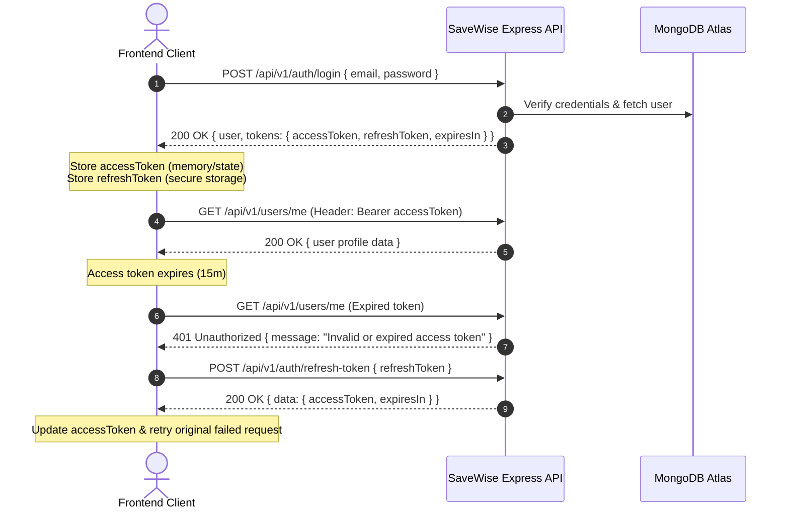

# SaveWise API — Postman Collection & Frontend Integration Reference

This reference is tailored for **Front-End Engineers** (React, Next.js, Vue, React Native, Flutter, Angular) integrating with the **SaveWise REST API**. It details endpoint contracts, JWT token lifecycle strategies, request/response payloads, validation rules, savings goals, deposits, wallet balance, transaction history, the customizable 20% savings rule recommendation engine, and instructions for importing the collection into your Postman account.

---

## 📌 Quick Reference & Environments

| Environment | Base URL (`{{baseUrl}}`) | Status | Description |
| :--- | :--- | :--- | :--- |
| **Live Production** | `https://save-wise-nodejs-api-server.onrender.com` | 🟢 Online | Hosted on Render with MongoDB Atlas |
| **Local Development** | `http://localhost:5000` | 💻 Local | Local Express API server |

- **API Version Route Prefix:** `/api/v1`
- **Default Content-Type:** `application/json`
- **Auth Header:** `Authorization: Bearer <accessToken>`

---

## 📥 Importing into Your Postman Account

The collection file is located in the root of the repository:
📁 **[`SaveWise_API_Collection.json`](./SaveWise_API_Collection.json)**

### Step-by-Step Import to Postman Account Workspace:
1. Open your **Postman** desktop app or navigate to **[Postman Web](https://go.postman.co)**.
2. Ensure you are signed in to your Postman account (e.g. Workspace: *SaveWise* or *My Workspace*).
3. Click the **Import** button in the top-left corner of the sidebar.
4. Drag and drop `SaveWise_API_Collection.json` (or click **files** and select it).
5. Postman will automatically create the collection:
   **`SaveWise API - v1 (Node.js Express TypeScript MongoDB Atlas)`**
6. Select the collection and open the **Variables** tab:
   - `baseUrl`: Set to `https://save-wise-nodejs-api-server.onrender.com` (for live) or `http://localhost:5000` (for local).
   - `accessToken`: (Auto-populated by Register/Login test scripts).
   - `refreshToken`: (Auto-populated by Register/Login test scripts).
   - `goalId`: (Auto-populated when creating a goal).
7. *(Optional for Sharing)*: Click the three dots `...` next to the collection in Postman -> **Share** -> Share with your team or generate a public view link for fellow front-end engineers.

---

## 🔐 Authentication & JWT Dual-Token Architecture

SaveWise uses a secure dual-token authentication pattern:
- **Access Token:** Short-lived JWT (`15m`) used to authorize protected routes (`/api/v1/users/*`, `/api/v1/goals/*`, `/api/v1/wallet/*`). Sent in the `Authorization` header as `Bearer <token>`.
- **Refresh Token:** Long-lived JWT (`30d`) used exclusively to obtain fresh access tokens via `POST /api/v1/auth/refresh-token`.



### 💡 Front-End Axios Interceptor Pattern (Silent Token Refresh)
```typescript
import axios from 'axios';

const api = axios.create({
  baseURL: 'https://save-wise-nodejs-api-server.onrender.com/api/v1',
});

let accessToken: string | null = null;

export const setAccessToken = (token: string | null) => {
  accessToken = token;
};

// Request Interceptor: Attach Bearer Token
api.interceptors.request.use((config) => {
  if (accessToken && !config.headers.Authorization) {
    config.headers.Authorization = `Bearer ${accessToken}`;
  }
  return config;
});

// Response Interceptor: Silent Token Refresh on 401
api.interceptors.response.use(
  (response) => response,
  async (error) => {
    const originalRequest = error.config;
    if (error.response?.status === 401 && !originalRequest._retry) {
      originalRequest._retry = true;
      try {
        const storedRefreshToken = localStorage.getItem('refreshToken');
        if (!storedRefreshToken) throw new Error('No refresh token available');

        const { data } = await axios.post(
          'https://save-wise-nodejs-api-server.onrender.com/api/v1/auth/refresh-token',
          { refreshToken: storedRefreshToken }
        );

        const newAccessToken = data.data.accessToken;
        setAccessToken(newAccessToken);
        originalRequest.headers.Authorization = `Bearer ${newAccessToken}`;
        return api(originalRequest);
      } catch (refreshErr) {
        setAccessToken(null);
        localStorage.removeItem('refreshToken');
        window.location.href = '/login';
        return Promise.reject(refreshErr);
      }
    }
    return Promise.reject(error);
  }
);

export default api;
```

---

## 📦 Standard API Response Envelopes

All responses from SaveWise adhere strictly to the standardized envelope.

### 1. Success Response Structure (`200 OK` / `201 Created`)
```json
{
  "success": true,
  "message": "Operation successful description",
  "data": { ... }
}
```

### 2. Standard Error Response (`400`, `401`, `403`, `404`, `409`, `500`)
```json
{
  "success": false,
  "message": "Specific error explanation"
}
```

### 3. Zod Validation Error Response (`422 Unprocessable Entity`)
```json
{
  "success": false,
  "message": "Validation failed",
  "errors": [
    {
      "field": "password",
      "message": "Password must be at least 8 characters long and include at least one uppercase letter, one number, and one special character"
    },
    {
      "field": "email",
      "message": "Invalid email address format"
    }
  ]
}
```

---

## 📡 Endpoint Specifications & Payloads

### 1. System & Health

#### `GET /` — Welcome & Directory
- **Auth:** None
- **Response `200 OK`:** Returns API status and directory of all available endpoint paths.

#### `GET /health` — Service Health & Uptime
- **Auth:** None
- **Response `200 OK`:** `{"status": "ok", "uptime": "2h 15m 32s", "timestamp": "..."}`

---

### 2. Authentication (`/api/v1/auth`)

#### `POST /api/v1/auth/register` — User Registration
- **Auth:** None
- **Request Body:**
```json
{
  "email": "sarah.smith@example.com",
  "password": "SecurePassword123!",
  "firstName": "Sarah",
  "lastName": "Smith",
  "phoneNumber": "+254712345678",
  "dateOfBirth": "1995-06-15"
}
```
- **Response `201 Created`:** Returns `user` object and `tokens: { accessToken, refreshToken, expiresIn }`.
- **Errors:** `409 Conflict` (Email duplicate), `422 Unprocessable Entity` (Field validation).

#### `POST /api/v1/auth/login` — User Login
- **Auth:** None
- **Request Body:**
```json
{
  "email": "sarah.smith@example.com",
  "password": "SecurePassword123!"
}
```
- **Response `200 OK`:** Returns `user` object and `tokens`.
- **Errors:** `401 Unauthorized` (Wrong email/password).

#### `POST /api/v1/auth/refresh-token` — Token Rotation
- **Auth:** None
- **Request Body:** `{"refreshToken": "eyJhbGciOi..."}`
- **Response `200 OK`:** `{"data": {"accessToken": "...", "expiresIn": "15m"}}`

#### `POST /api/v1/auth/forgot-password` — Request Reset Code
- **Auth:** None
- **Request Body:**
```json
{
  "email": "sarah.smith@example.com"
}
```
- **Response `200 OK`:**
```json
{
  "success": true,
  "message": "If an account with that email exists, a password reset code has been sent.",
  "data": {
    "message": "If an account with that email exists, a password reset code has been sent.",
    "devOtp": "648192"
  }
}
```

#### `POST /api/v1/auth/reset-password` — Verify Code & Reset Password
- **Auth:** None
- **Request Body:**
```json
{
  "email": "sarah.smith@example.com",
  "otp": "648192",
  "newPassword": "NewSecurePassword123!"
}
```
- **Response `200 OK`:** `{"success": true, "message": "Password has been reset successfully. You can now log in."}`
- **Errors:** `400 Bad Request` (Invalid/expired OTP, or $\ge 3$ failed attempts).

---

### 3. User Profile (`/api/v1/users`)

#### `GET /api/v1/users/me` — Current Profile
- **Auth:** `Bearer <accessToken>`
- **Response `200 OK`:** Returns user profile, status, `walletBalanceKobo`, and settings.

#### `PATCH /api/v1/users/me` — Update Profile
- **Auth:** `Bearer <accessToken>`
- **Request Body (all optional):** `{"firstName": "Sarah", "lastName": "Jenkins", "avatarUrl": "https://..."}`

---

### 4. Savings Goals (`/api/v1/goals`)

#### `POST /api/v1/goals` — Create Savings Goal
- **Auth:** `Bearer <accessToken>`
- **Request Body:**
```json
{
  "name": "Emergency Fund 2027",
  "targetAmountKobo": 50000000,
  "currency": "NGN",
  "targetDate": "2027-12-31T00:00:00.000Z",
  "autoSave": {
    "enabled": true,
    "amountKobo": 500000,
    "frequency": "MONTHLY"
  }
}
```
- **Response `201 Created`:**
```json
{
  "success": true,
  "message": "Savings goal created successfully",
  "data": {
    "id": "6742a1b9e830...",
    "name": "Emergency Fund 2027",
    "targetAmountKobo": 50000000,
    "currentBalanceKobo": 0,
    "currency": "NGN",
    "targetDate": "2027-12-31T00:00:00.000Z",
    "status": "ACTIVE",
    "progressPercentage": 0,
    "autoSave": {
      "enabled": true,
      "amountKobo": 500000,
      "frequency": "MONTHLY"
    },
    "createdAt": "2026-11-24T09:40:00.000Z"
  }
}
```

#### `GET /api/v1/goals` — List All User Goals
- **Auth:** `Bearer <accessToken>`
- **Optional Query:** `?status=ACTIVE` (`ACTIVE` | `COMPLETED` | `CANCELLED`)
- **Response `200 OK`:**
```json
{
  "success": true,
  "message": "Savings goals retrieved successfully",
  "data": {
    "goals": [ ... ],
    "totalSavingsKobo": 12500000,
    "count": 3
  }
}
```

#### `GET /api/v1/goals/:id` — Get Goal Details
- **Auth:** `Bearer <accessToken>`
- **Response `200 OK`:** Single goal object with live progress percentage.

#### `PATCH /api/v1/goals/:id` — Update Goal
- **Auth:** `Bearer <accessToken>`
- **Request Body (all optional):** `{"name": "Emergency Fund Updated", "targetAmountKobo": 60000000, "status": "ACTIVE"}`

#### `DELETE /api/v1/goals/:id` — Delete / Cancel Goal
- **Auth:** `Bearer <accessToken>`
- **Response `200 OK`:** Goal deleted. Any remaining balance is automatically refunded back to the user's wallet!

#### `POST /api/v1/goals/:id/deposit` — Deposit into Goal
- **Auth:** `Bearer <accessToken>`
- **Request Body:**
```json
{
  "amountKobo": 250000,
  "source": "WALLET",
  "reason": "Weekly savings deposit"
}
```
- *(Note: `source` can be `"WALLET"` or `"SIMULATED_CARD"`. If `"WALLET"`, funds are validated and deducted from `walletBalanceKobo`).*
- **Response `200 OK`:**
```json
{
  "success": true,
  "message": "Deposit to savings goal successful",
  "data": {
    "goal": {
      "id": "6742a1b9e830...",
      "currentBalanceKobo": 250000,
      "progressPercentage": 5,
      "status": "ACTIVE"
    },
    "transaction": {
      "id": "...",
      "reference": "DEP_1732441200_A9B2",
      "amountKobo": 250000,
      "type": "DEPOSIT",
      "status": "SUCCESS"
    }
  }
}
```

---

### 5. Wallet, Transactions & 20% Recommendation Engine (`/api/v1/wallet`)

#### `GET /api/v1/wallet` — Wallet & Net Worth Summary
- **Auth:** `Bearer <accessToken>`
- **Response `200 OK`:**
```json
{
  "success": true,
  "message": "Wallet summary retrieved successfully",
  "data": {
    "walletBalanceKobo": 5000000,
    "totalSavingsKobo": 250000,
    "netWorthKobo": 5250000,
    "activeGoalsCount": 1,
    "currency": "NGN",
    "settings": {
      "targetSavingsPercentage": 20,
      "monthlyIncomeKobo": 20000000,
      "currency": "NGN"
    }
  }
}
```

#### `POST /api/v1/wallet/deposit` — Fund Wallet
- **Auth:** `Bearer <accessToken>`
- **Request Body:**
```json
{
  "amountKobo": 5000000,
  "paymentMethod": "CARD",
  "reason": "Wallet top-up"
}
```
- **Response `200 OK`:** Returns updated `walletBalanceKobo` and transaction receipt.

#### `PATCH /api/v1/wallet/settings` — Readjust Savings Target Percentage
Allows the user to adjust the default 20% savings rule to any preferred target (e.g. 15%, 25%, 30%), set monthly income, and configure currency.
- **Auth:** `Bearer <accessToken>`
- **Request Body:**
```json
{
  "targetSavingsPercentage": 25,
  "monthlyIncomeKobo": 25000000,
  "currency": "NGN"
}
```
- **Response `200 OK`:**
```json
{
  "success": true,
  "message": "Savings settings updated. Target set to 25%.",
  "data": {
    "settings": {
      "targetSavingsPercentage": 25,
      "monthlyIncomeKobo": 25000000,
      "currency": "NGN"
    }
  }
}
```

#### `GET /api/v1/wallet/recommendation` — Dynamic Savings Recommendation
Evaluates the user's savings performance against their customizable savings rule (defaulting to the classic 20% rule, dynamically adjusted if user updated their settings):
- **Auth:** `Bearer <accessToken>`
- **Response `200 OK`:**
```json
{
  "success": true,
  "message": "Savings recommendation retrieved successfully",
  "data": {
    "rule": "25% Savings Rule",
    "targetSavingsPercentage": 25,
    "monthlyIncomeKobo": 25000000,
    "recommendedMonthlySavingsKobo": 6250000,
    "recommendedWeeklySavingsKobo": 1562500,
    "recommendedDailySavingsKobo": 208333,
    "actualSavedLast30DaysKobo": 2500000,
    "progressRatePercentage": 40,
    "onTrack": false,
    "advice": "Based on your configured 25% target and monthly income of 250,000 NGN, we recommend setting aside 62,500 NGN each month. You can readjust this percentage anytime in /api/v1/wallet/settings."
  }
}
```

#### `GET /api/v1/wallet/transactions` — Transaction History
- **Auth:** `Bearer <accessToken>`
- **Optional Queries:** `?page=1&limit=20&type=DEPOSIT` (`WALLET_FUND` | `DEPOSIT` | `WITHDRAWAL` | `AUTO_SAVE`)
- **Response `200 OK`:**
```json
{
  "success": true,
  "message": "Transaction history retrieved successfully",
  "data": {
    "transactions": [
      {
        "id": "6742a5c102...",
        "reference": "DEP_1732441200_A9B2",
        "type": "DEPOSIT",
        "amountKobo": 250000,
        "currency": "NGN",
        "status": "SUCCESS",
        "reason": "Weekly savings deposit",
        "goal": {
          "id": "6742a1b9e830...",
          "name": "Emergency Fund 2027"
        },
        "createdAt": "2026-11-24T09:45:00.000Z"
      }
    ],
    "pagination": {
      "total": 1,
      "page": 1,
      "limit": 20,
      "totalPages": 1
    }
  }
}
```

---

## 🧪 Postman Automated Test Suite & Newman CLI

The collection now includes **29 automated test requests** covering:
- ✅ **System:** Welcome root route & health check uptime string format
- ✅ **Authentication:** Registration, Login, Token Refresh, Forgot Password OTP request, Reset Password verification
- ✅ **Negative Validation:** Email regex (422), Password complexity (422), Missing names (422), Invalid credentials (401), Tampered Bearer token (401)
- ✅ **User Profile:** Get Current User (`/me`), Update Profile (`PATCH /me`)
- ✅ **Savings Goals:** Create Goal (201), List Goals (200), Get Goal by ID (200), Update Goal (200), Deposit into Goal (200)
- ✅ **Wallet & Recommendations:** Get Wallet Summary (200), Fund Wallet (200), Readjust Target Percentage (200), Get Dynamic Recommendation (200), Paginated Transaction History (200)

```bash
# Run locally (starts server with dev and runs newman)
npm run test:api

# Run against Render live deployment (once pushed)
npm run test:api:live
```
